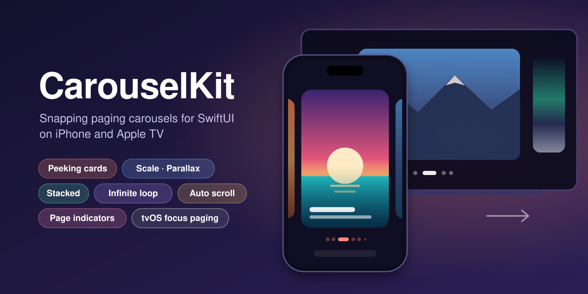
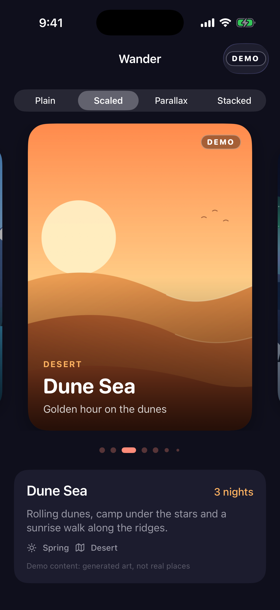
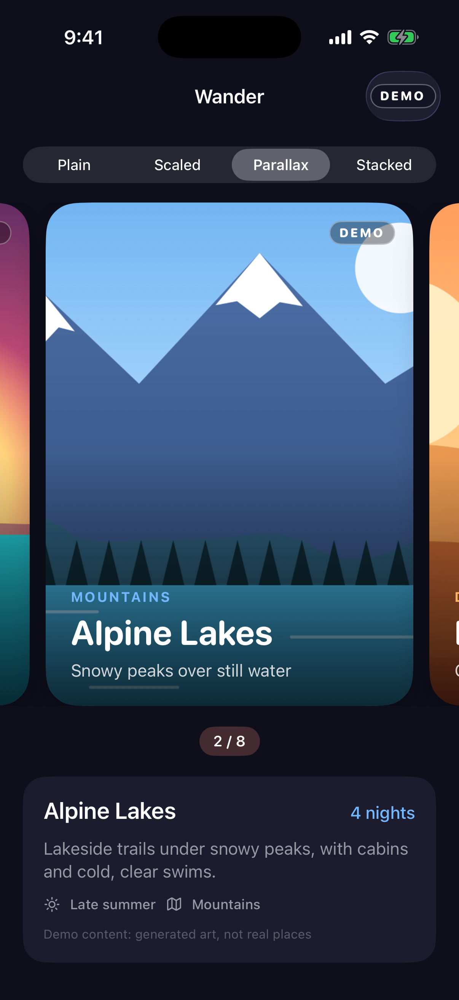
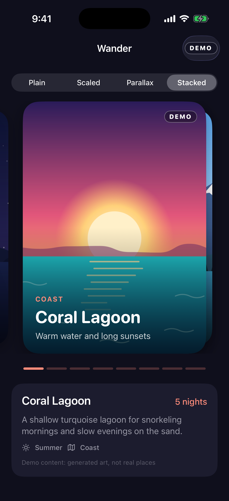
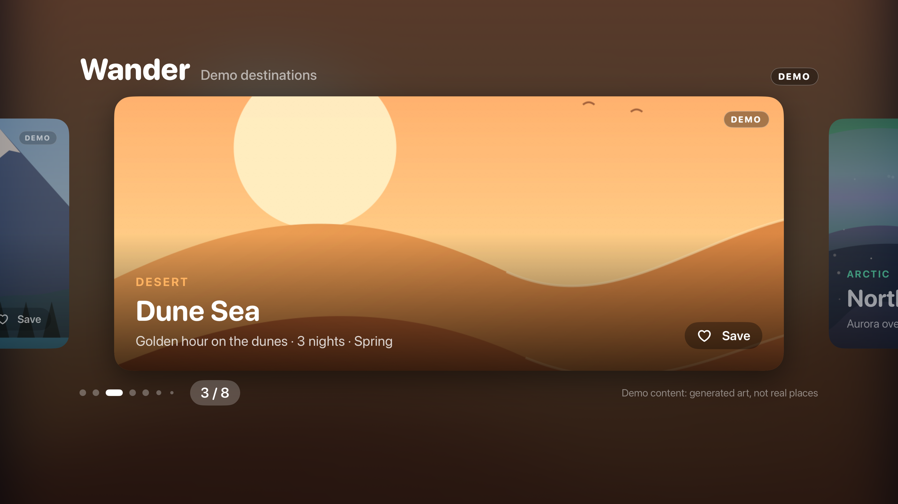

<p align="center">
  
</p>

<p align="center">
  <a href="https://github.com/halilozel1903/CarouselKit/actions/workflows/ci.yml"></a>
  
  
  
  
  
  <a href="LICENSE"></a>
</p>

**CarouselKit** gives SwiftUI a paging carousel for **iPhone and Apple TV**. Cards snap one page at a time with their neighbors peeking in at the sides, and you can make them scale, slide with parallax or stack like a deck. A carousel can loop forever, scroll on its own and pause while someone touches it, and bind its current page to your state. `PageIndicator` shows the page as dots, a line, "3 / 8" or progress segments. On Apple TV, moving focus pages the carousel. It's built on `scrollTargetBehavior`, `containerRelativeFrame` and `scrollPosition`, with no UIKit and no dependencies.

```swift
import CarouselKit

@State private var page = 0

Carousel(destinations, index: $page, spacing: 14, peek: 26, style: .scaled) { destination in
    DestinationCard(destination)
}
.frame(height: 440)
.carouselLoops()
.carouselAutoScroll(every: 4)

PageIndicator(count: destinations.count, index: $page, style: .dots)
```

## Screenshots

CI captured these from the example app, *Wander*, on an iPhone simulator and an Apple TV 4K simulator. **The content is demo content.** The destinations have generic made-up names (Coral Lagoon, Alpine Lakes, Dune Sea…), and the gradient illustrations were generated for this repository and ship inside the app. They aren't photos and they don't show real places. Nothing is loaded from the network.

| `.scaled` + dots | `.parallax` + "2 / 8" | `.stacked` + progress |
| :---: | :---: | :---: |
|  |  |  |

| Apple TV: focus-driven carousel |
| :---: |
|  |

## Features

- **Snapping pages with peeking neighbors.** Each page is as wide as the carousel minus `peek` and `spacing` on both sides (`containerRelativeFrame`), and `scrollTargetBehavior(.viewAligned)` centers one page per swipe.
- **Four styles.** `.plain`, `.scaled` (neighbors shrink and fade), `.parallax` (marked layers move slower than their card) and `.stacked` (the next cards wait under the current one like a deck). Every style takes parameters, for example `.scaled(minimumScale: 0.8)`.
- **Infinite looping.** `.carouselLoops()` repeats the pages and quietly recenters, so you can swipe in either direction forever. Setting the index takes the shorter way around.
- **Auto scroll that gets out of the way.** `.carouselAutoScroll(every:resumeAfter:)` advances on a timer. It pauses while someone drags, swipes or moves focus, and resumes after a delay. It stops while Reduce Motion is on and while the carousel is off screen.
- **A bound page index.** `index: $page` follows swipes, and setting it scrolls the carousel.
- **`PageIndicator`.** Four styles: `.dots` (they scroll and shrink at the edges when there are many pages), `.line`, `.numbered` ("3 / 8") and `.progress`. With a binding you can tap a dot or segment, and it works with VoiceOver's adjustable action.
- **Apple TV focus paging.** Every page is focusable. Moving focus left or right pages the carousel, and the focused card lifts. `onSelect` handles the click.
- **Tested logic.** Index wrapping, loop mapping, auto-scroll timing, the style transforms and the dot window are plain value types with Swift Testing tests. The tests run on macOS and on iOS and tvOS simulators.

## API

| Type or modifier | What it does |
| --- | --- |
| `Carousel(_:index:spacing:peek:style:onSelect:content:)` | A paging carousel of any `RandomAccessCollection`. Every parameter except the data and the content has a default. |
| `CarouselStyle` | `.plain`, `.scaled`, `.scaled(minimumScale:minimumOpacity:)`, `.parallax`, `.parallax(amount:)`, `.stacked`, `.stacked(visibleCards:offset:scaleStep:)` |
| `.carouselLoops(_:)` | Repeats the pages endlessly in both directions. |
| `.carouselAutoScroll(every:resumeAfter:isEnabled:)` | Advances every `every` seconds and waits `resumeAfter` seconds after an interaction. |
| `.carouselParallax(_:)` | Marks a layer inside a page, such as its background art, to lag behind in a `.parallax` carousel. |
| `PageIndicator(count:index:style:)` | A page indicator. Pass a `Binding<Int>` to make it interactive or an `Int` to only display the page. |
| `PageIndicatorStyle` | `.dots`, `.dots(maximumVisible:)`, `.line`, `.numbered`, `.progress` |
| `CarouselDefaults` | The default `spacing` and `peek` for the platform (16/28 pt on iOS, 48/160 pt on tvOS). |
| `CarouselIndex` | Pure helpers: `wrapped`, `clamped`, `step(from:by:count:loops:)`, `nextAutoScrollIndex`, `shortestOffset`. |
| `LoopLayout` | Maps the slots of a looping carousel to pages and finds slots for recentering. |
| `AutoScrollTimer` | The auto-scroll timing state: deadlines, pausing, resuming and progress. |
| `DotWindow` | Which dots a dotted indicator shows and how large each one is. |

## Installation

### Swift Package Manager

In Xcode, choose **File › Add Package Dependencies…** and enter:

```
https://github.com/halilozel1903/CarouselKit.git
```

Or add it to `Package.swift`:

```swift
dependencies: [
    .package(url: "https://github.com/halilozel1903/CarouselKit.git", from: "1.0.0"),
],
targets: [
    .target(name: "MyApp", dependencies: ["CarouselKit"]),
]
```

## Usage

### A carousel

```swift
Carousel(cards) { card in
    CardView(card)
}
.frame(height: 320)
```

The carousel is as tall as its tallest page, so give it or its pages a height. `spacing` is the gap between pages, and `peek` is how much of the previous and next page stays visible. The pages scroll inside the carousel's frame. Use the full width for a carousel that should run to the screen edges.

### Styles

```swift
Carousel(cards, style: .plain)   { CardView($0) }   // side by side
Carousel(cards, style: .scaled)  { CardView($0) }   // neighbors at 86 % size and 65 % opacity
Carousel(cards, style: .stacked) { CardView($0) }   // a deck: next cards wait underneath

Carousel(cards, style: .scaled(minimumScale: 0.8, minimumOpacity: 0.4)) { CardView($0) }
Carousel(cards, style: .stacked(visibleCards: 3, offset: 18, scaleStep: 0.06)) { CardView($0) }
```

A style turns each page's distance from the center (its *progress*: 0 when centered, ±1 one page away) into a scale, an offset and an opacity, which are applied with `visualEffect`. Your page views stay untouched.

### Parallax

In a `.parallax` carousel the cards move at scroll speed, and the layers you mark with `.carouselParallax()` move slower, which adds depth. Mark the layer that should lag, usually the background art. It's scaled up just enough to keep covering its frame and is clipped to that frame:

```swift
Carousel(destinations, style: .parallax(amount: 0.2)) { destination in
    ZStack(alignment: .bottomLeading) {
        Color.clear
            .overlay { Image(destination.art).resizable().scaledToFill() }
            .carouselParallax()          // lags 20 % behind
        Text(destination.name)           // moves with the card
    }
    .clipShape(.rect(cornerRadius: 24))
}
```

`.carouselParallax(2)` makes a layer twice as deep, and a negative factor moves it the other way. Outside a `.parallax` carousel the modifier changes nothing.

### Bound index

```swift
@State private var page = 0

Carousel(items, index: $page) { ItemCard($0) }
Button("Next") { page += 1 }
Text(items[page].title)
```

The binding updates as pages snap into place. Setting it scrolls with an animation, and out-of-range values are clamped. In a looping carousel, going from the last page to the first moves one page forward instead of rewinding.

### Infinite loop

```swift
Carousel(items) { ItemCard($0) }
    .carouselLoops()
```

A looping carousel repeats the pages in 21 copies inside a lazy stack and starts in the middle copy. When scrolling comes within a few copies of either end and the carousel is at rest, it jumps without animation to the same page in the middle copy. The jump isn't visible, and `index` keeps reporting the real page. A carousel with one page never loops.

### Auto scroll

```swift
Carousel(banners) { BannerView($0) }
    .carouselLoops()
    .carouselAutoScroll(every: 5, resumeAfter: 8)
```

- The carousel advances a page every `every` seconds.
- On iOS 18 and tvOS 18, dragging pauses auto scroll for as long as the finger is down (`onScrollPhaseChange`). A swipe, a focus move, a tap on a page indicator or a change of `index` restarts the wait.
- After an interaction the carousel waits `resumeAfter` seconds, by default one interval, before it moves again.
- Without `.carouselLoops()` the carousel rewinds to the first page after the last.
- Auto scroll is off while Reduce Motion is on and while the carousel isn't on screen. Pass `isEnabled: false` to turn it off, for example in tests or screenshots.

The timing lives in `AutoScrollTimer`, a value type you can also use for your own timers or tests:

```swift
var timer = AutoScrollTimer(interval: 4, resumeDelay: 6, now: 0)
timer.shouldAdvance(at: 4)        // true
timer.interactionBegan(at: 5)     // paused: nextFireTime == nil
timer.interactionEnded(at: 9)     // next page due at 15
```

### Page indicators

```swift
PageIndicator(count: items.count, index: $page)                     // dots
PageIndicator(count: items.count, index: $page, style: .line)
PageIndicator(count: items.count, index: page, style: .numbered)   // "3 / 8", display only
PageIndicator(count: items.count, index: $page, style: .progress)
    .tint(.orange)
```

The current page is drawn in the tint color and the other pages in the tint at a lower opacity. With more pages than `.dots(maximumVisible:)` (7 by default), the dots scroll and the ones at the edges shrink, like the system page control. The indicator reads as "Page 3 of 8" to VoiceOver, and with a binding VoiceOver can swipe it up and down to change the page.

### Apple TV

```swift
Carousel(shows, index: $page, style: .scaled, onSelect: { show in open(show) }) { show in
    ShowBanner(show)
}
.frame(height: 560)
```

On tvOS each page is a focusable button. Moving focus left or right brings the next page to the center, and the focused page lifts and casts a shadow. Clicking calls `onSelect`. When the carousel scrolls by itself (auto scroll or a new `index`) while it has focus, focus follows the centered page. The carousel is a focus section, and the centered page has default focus. The tvOS defaults are larger: 48 pt spacing and 160 pt peek.

## How it works

- **Layout.** A horizontal `ScrollView` holds a `LazyHStack` marked with `scrollTargetLayout()`. Each page uses `containerRelativeFrame(.horizontal)`. `safeAreaPadding(.horizontal, peek + spacing)` makes room for the neighbors, and `scrollTargetBehavior(.viewAligned(limitBehavior: .always))` snaps one page per swipe.
- **Position.** `scrollPosition(id:anchor: .center)` reports the centered slot. A slot is a page's position in the scroll view. `LoopLayout` maps slots to pages and back.
- **Effects.** `visualEffect` reads each page's position relative to the scroll view's bounds, turns it into progress, and applies the style's `CarouselTransform`. Nothing is re-laid out while scrolling.
- **Auto scroll.** A task sleeps until `AutoScrollTimer`'s next deadline, then scrolls with an animation. Interactions update the timer.

## Example app

`Example/` contains *Wander*, a demo travel app for iPhone and Apple TV. Its eight destination cards and their gradient illustrations are made up and bundled (`Example/Shared/DemoDestinations.swift`, `Example/Shared/Art.xcassets`), and every card is marked **DEMO**. The iPhone app has a segmented picker for the four styles, each with a different page indicator. The Apple TV app shows a full-screen focus-driven carousel.

```bash
brew install xcodegen
cd Example && xcodegen generate
open CarouselKitDemo.xcodeproj
```

Run `WanderPhone` on an iPhone simulator and `WanderTV` on an Apple TV simulator. Normal launches loop and auto scroll. To open the fixed scenes that CI captures for the screenshots above, launch with `-screenshot scaled|parallax|stacked` (iPhone) or `-screenshot carousel` (Apple TV).

## Requirements

- Xcode 26 or later (Swift 6.2 toolchain)
- iOS 17+ or tvOS 17+ (macOS 14+ only to run the tests)
- Pausing auto scroll while a finger is down needs iOS 18 or tvOS 18. On 17, a change of page restarts the wait instead.

## Contributing

Issues and pull requests are welcome. Please run the tests before opening a PR:

```bash
swift test
bash scripts/test.sh iOS
bash scripts/test.sh tvOS
```

## License

CarouselKit is available under the MIT license. See [LICENSE](LICENSE).
